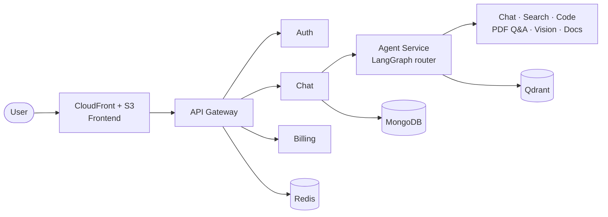

 

 

> **B.Tech CSE (Data Science), GLBITM · Batch 2027.** I design and ship backend systems end to end: microservices, real-time features, caching, payments, AI agent pipelines and cloud deployment. I also compete in algorithmic contests.

---

## 🏆 Contest Record

<table>
<tr>
<td align="center" width="25%">
<h1>🌏</h1>
<b>ICPC Regionalist</b> 
Asia West Amritapuri Regional Jan 1–2, 2027 · Bengaluru
</td>
<td align="center" width="25%">
<h1>⭐ 1788</h1>
<b>LeetCode</b> 
Peak rating in live contests
</td>
<td align="center" width="25%">
<h1>🏁 1312</h1>
<b>Codeforces</b> 
Pupil · actively competing
</td>
<td align="center" width="25%">
<h1>🧩 900+</h1>
<b>Problems Solved</b> 
LeetCode · GFG · Codeforces
</td>
</tr>
</table>

🥇 Top 2 in my institute on the CP-31 sheet &nbsp;·&nbsp; 🥈 Runner-Up, Intercollege Ideathon (team lead of 5)

---

## 🛠️ Tech Stack

<table>
<tr>
<td width="18%"><b>Languages</b></td>
<td></td>
</tr>
<tr>
<td><b>Backend</b></td>
<td> &nbsp;REST · Microservices · MVC · JWT · RBAC · Socket.IO</td>
</tr>
<tr>
<td><b>Databases</b></td>
<td> &nbsp;</td>
</tr>
<tr>
<td><b>AI Engineering</b></td>
<td>  </td>
</tr>
<tr>
<td><b>Cloud & DevOps</b></td>
<td> &nbsp;ECS · ECR · S3 · CloudFront</td>
</tr>
<tr>
<td><b>Tools</b></td>
<td></td>
</tr>
</table>

---

## 💼 Projects

### 🤖 Gyaani AI &nbsp;  

**The problem:** Different AI tasks need different tools. One model is good at chatting, another at reading PDFs, another at writing code. Switching between apps wastes time, and one overloaded service can slow everything down.

**What I built:** One AI assistant that understands what you're asking and hands it to the right specialist agent. Drop in a PDF and it answers strictly from that document. Ask for code, search, or a generated document and a different agent picks it up. Underneath, it's split into independent services for login, chat, billing, and the AI agents, with credits, payments, and fair-use limits built in. Every change I push is built, packaged, and deployed to the cloud automatically.

 

### 🎓 HireSync &nbsp; 

**The problem:** A final-year student hunting for a job has opportunities scattered across ten different websites, WhatsApp groups, and a flooded email inbox. Good chances get missed simply because nobody saw them.

**What I built:** One website that pulls every opportunity into a single place. Students, recruiters, and college placement officers each get their own view. Everyone gets alerted the moment something changes, so nothing gets missed.

---

## 📈 GitHub Activity

  

**Open to SDE internships and full-time roles** · 📧 priyank0saxena@gmail.com

